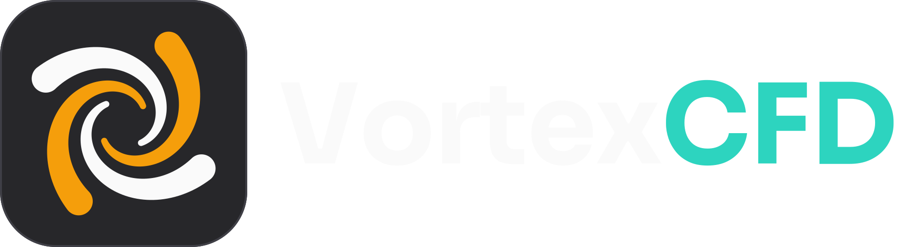

<p align="center"></p>

# VortexCFD

A desktop workflow for steady, incompressible CFD on top of OpenFOAM ESI v2606: geometry, domain, mesh, physics,
run and results in one simulation tree (Python, PySide6, PyVista), running in WSL2 Ubuntu 24.04.

**User manual: [docs/manual/README.md](docs/manual/README.md)** (also Help > User Manual in the app).

## Install

On WSL2 Ubuntu 24.04, install OpenFOAM v2606 with the official ESI packages, then run the install script from this
checkout (details: [docs/manual/01_installation.md](docs/manual/01_installation.md)):

```bash
scripts/install.sh
```

```bash
vortexcfd --version
```

## Development

```bash
python3 -m venv .venv
```

```bash
.venv/bin/pip install -e ".[dev]"
```

Run the fast tests offscreen (CLAUDE.md lists the project rules):

```bash
QT_QPA_PLATFORM=offscreen .venv/bin/pytest -q -m "not slow and not validation and not long"
```

Architecture: ARCHITECTURE.md. Decisions: DECISIONS.md. Plan and status: docs/PLAN.md, docs/STATUS.md. Validation
records: docs/validation/. How to contribute: [CONTRIBUTING.md](CONTRIBUTING.md).

## Licence

VortexCFD's own code is licensed under the GNU General Public License, version 3 or (at your option) any later
version (GPL-3.0-or-later); the full text is in [LICENSE](LICENSE). VortexCFD uses foamlib, which is licensed under
GPL-3.0-only, so VortexCFD as distributed together with its dependencies (the combined work) is under GPL-3.0. The
licences of every dependency and of the external programs it runs (OpenFOAM, ParaView) are listed in
[THIRD_PARTY_LICENSES.md](THIRD_PARTY_LICENSES.md). The logo's word is set in the Sora font
(assets/branding/fonts/), licensed under the SIL Open Font License 1.1 (OFL-1.1; its text in
assets/branding/fonts/OFL.txt); the licence of the logo itself is still to be chosen by the owner.
