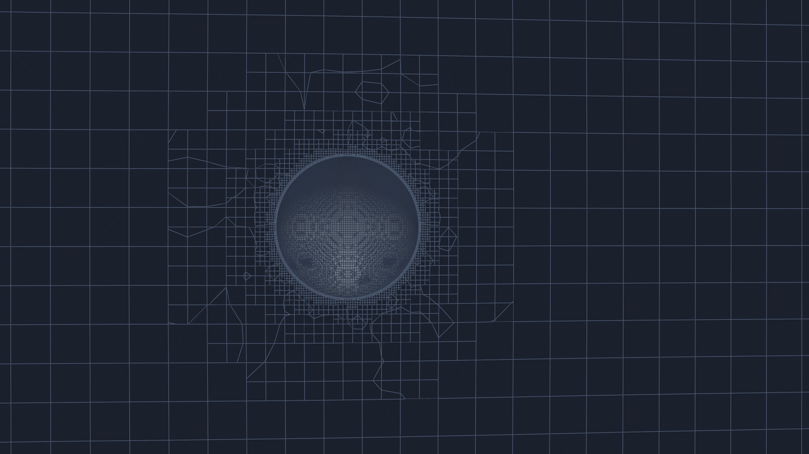
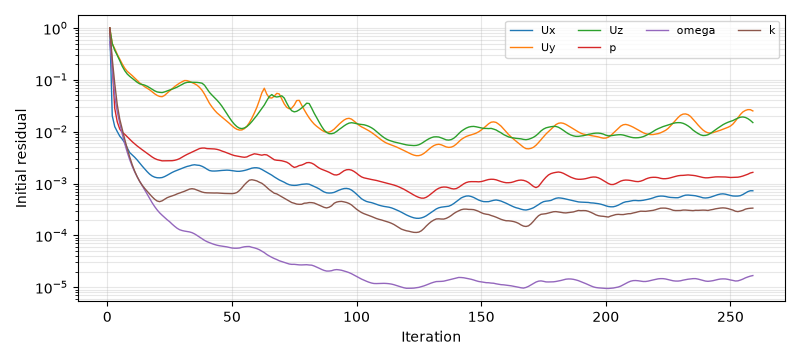
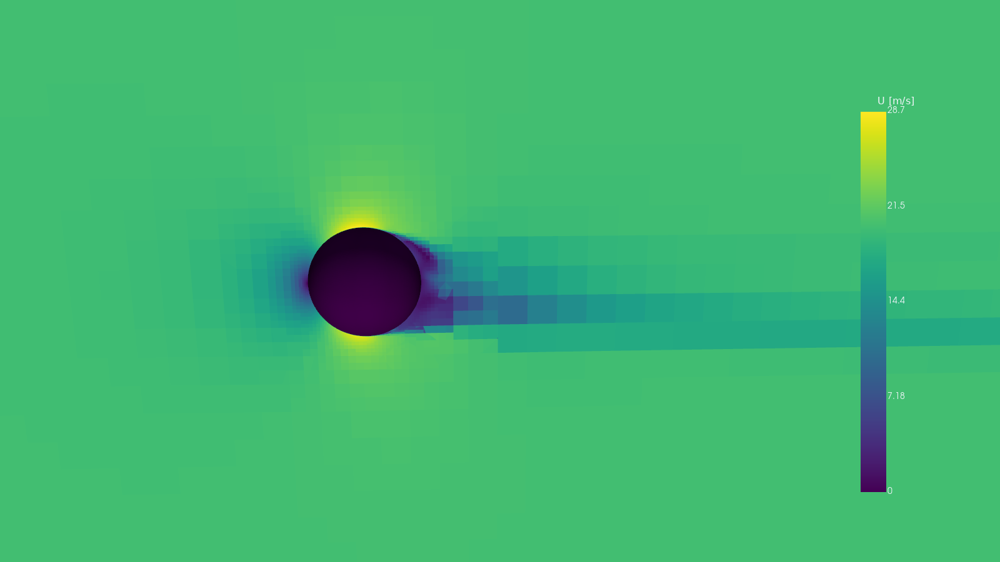
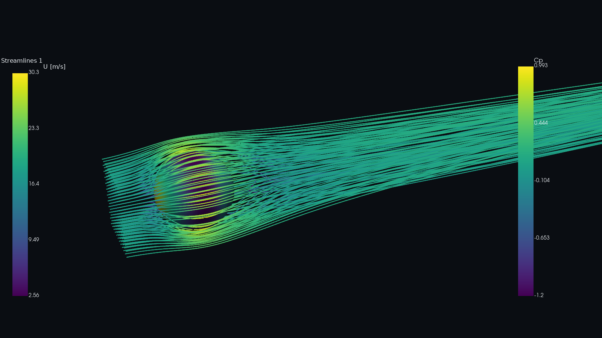
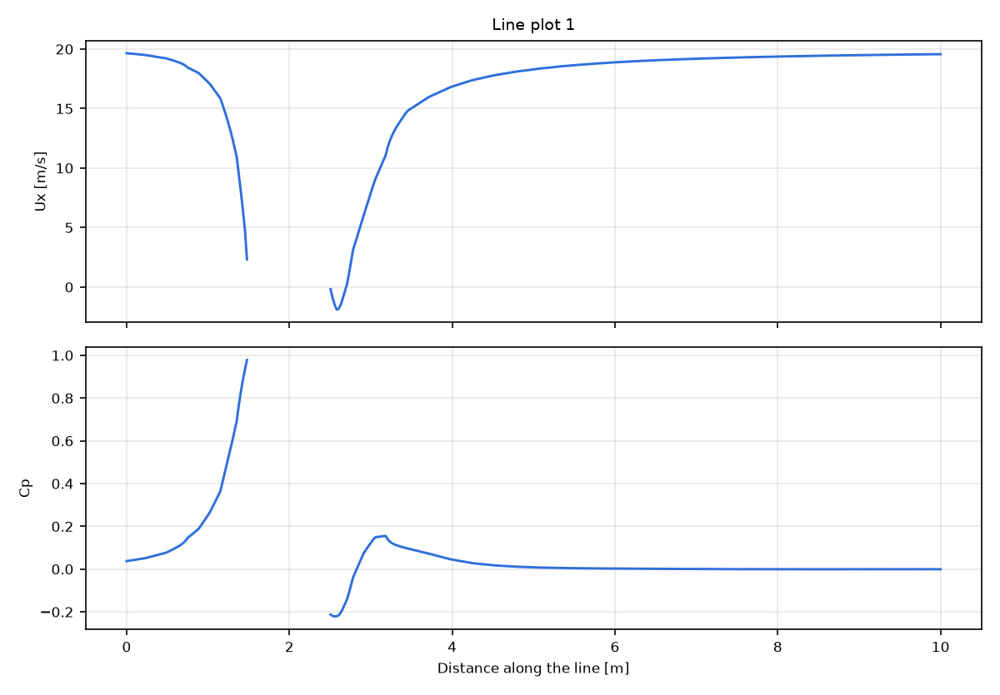

# 2. A first external case: a sphere

A sphere of 1 m diameter in a 20 m/s air stream (Re 1.3e6), from an empty start to a result, with the defaults.
The geometry is `benchmarks/geometries/sphere.stl` from the repository. On the development machine (8 cores) the
whole case took under 2 minutes: 29 s of meshing and 75 s of solving.

## 2.1 New simulation

Start VortexCFD. The Start dialog offers New simulation, Open and the recent projects. New simulation asks for a
name, a parent folder, a preset and the number of cores; choose the preset **External flow**. The project is a
folder `<parent>/<name>/` holding `<name>.vcfd`, `geometry/` and `case/`, and it is saved at once.

## 2.2 Import the geometry

File > Import Geometry (Ctrl+I): STL, OBJ, PLY, STEP, IGES or BREP. The file is copied into the project's
`geometry/`; you are asked for its units (here metres). A multi-solid STL becomes one part with a region per solid;
CAD faces keep their names. The part is checked (open edges, self-intersections, orientation): a part that is not
closed gets a warning and Edit > Repair part offers a repair.

With the External flow preset the far-field domain is generated around the parts on the first import:

*The domain box: 5 lengths upstream, 10 downstream, 5 to the sides (Regions > Fluid Domain sets the shape, the
sizes and an optional ground plane).*

## 2.3 Mesh

Continua > Mesh shows the sizing before you mesh: the background cells, the surface cell size, the curvature
refinement and the prism layers from the target y+ (here 50, wall functions). The defaults are a good start; see
chapter 6 for the choices. Press **Generate Mesh** (top bar). The console streams snappyHexMesh; the Mesh report
then shows the cells, checkMesh's verdict, the layer coverage per patch and the achieved first cell.

This sphere: 233,709 cells, Mesh OK, max non-orthogonality 46.5, every wall face with layers, first cell 1.80 mm
as planned.

*Mesh Scene, the section through the sphere: the background cells, the refinement towards the surface and the
layers.*

## 2.4 Physics and stopping

Physics: steady incompressible RANS with k-omega SST; the kinematic viscosity (default air, 1.5e-5 m²/s) and the
reference density. Physics > Inflow: the free-stream speed (20 m/s), the angle of attack and the turbulence
intensity. Reports & Monitors > Reference Values: the reference length, area and centre of rotation for the
coefficients (by default from the parts' box).

Solvers: the iteration limit, the cores, and the Stopping Criteria. A sphere at this Reynolds number sheds a wake
that a steady solver cannot settle, so this case stops on a **mean-stable** criterion on Cd (window 100 iterations,
tolerance 0.5 %), not on the residuals (chapter 7).

## 2.5 Run

Press **Run Solver**. The right column shows the convergence banner, the residuals and three report slots (click a
slot to assign a quantity: Cd, Cl, Cm, y+, a probe ...). Stop ends the run cleanly (the last time step is written).

This run met its criterion at iteration 259: Cd 0.188 as the mean of the last 100 iterations, oscillating by
about ±5 % about it; the walls' average y+ 48 (target 50). The residuals stalled near 1e-2, as expected for this
wake:

## 2.6 Results

The Results Scene tab shows the latest results: choose the field, the colormap, the colour range (auto, fixed,
symmetric) and the display (walls, section, both); move the section with its slider.

Add streamlines, clips, isosurfaces and line plots from the Results node (chapter 5):

A line plot along the axis through the sphere (the gap is the sphere itself):

This case is a demonstration, not a validation: the drag of a sphere near Re 1e6 lies in the drag crisis and
depends strongly on transition, which RANS does not model.
