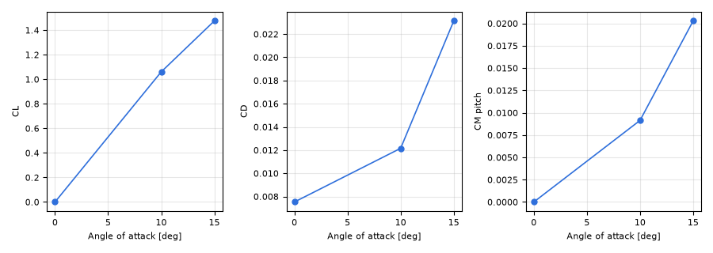
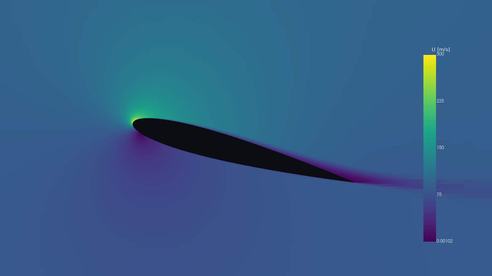

# 3. A 2D airfoil

The 2D mode meshes a section in the x-z plane as one cell across the span (y), with empty front and back patches
(D-121). For airfoils it is the quickest way to a polar.

## 3.1 The "2D airfoil" preset

File > New Simulation, preset **2D airfoil**. It sets the 2D dimension and wall-resolved layers: y+ 1 at the first
cell centre, a stack one surface cell thick, a 12-cell staircase of refinement around the airfoil (D-123, D-124).
The solver then runs in two turbulence stages inside one run: k and omega first order to the stopping criteria,
then second order to the criteria again; the monitors show the stage and the iteration of the switch (D-126).

## 3.2 Importing the airfoil

File > Import Airfoil reads a coordinate file in Selig or Lednicer format (the usual .dat files), with a scale
(the chord in metres when the file is in chord units) and the trailing-edge closure (blunt or sharp). The section is
the closed curve of the coordinates; the app builds the slab and the domain from it.

## 3.3 Angle of attack

Physics > Inflow > Angle of attack. The free stream always blows along +x; the angle is a rotation of the parts
about the reference centre of rotation, nose up positive (D-120). Each angle therefore has its own mesh, and the
forces are reported in wind axes (Cl normal to the free stream, Cd along it). Body-axis coefficients (C_axial,
C_normal) are available as report slots.

Check the reference values (Reports & Monitors > Reference Values): for a 2D section the reference area is the
chord times the span the app uses; the defaults come from the section's box.

## 3.4 The polar sweep

Reports & Monitors > Polar Sweep: the list of angles (start, end and step, or a list), then Run. Each angle is meshed
and solved in its own case (case_sweep/point_<n>/), one after the other; a stopped sweep resumes at the first angle
not finished. The results window plots CL against alpha, the drag polar and CM against alpha; points that did not
meet their stopping criteria are drawn hollow. Export CSV writes the table; the HTML report has the same table and
plot (chapter 5).

*The NACA 0012 at Re 6e6 through the preset at 0, 10 and 15 degrees (the round 3 validation results, as the
report draws a sweep).*

*|U| around the NACA 0012 at 15 degrees, Results Scene, display "Section".*

## 3.5 What to expect

Through the preset, with only the TMR inputs, the NACA 0012 at Re 6e6 is within 2.3 % of the NASA TMR SST lift and
6.9 % of its drag at 0, 10 and 15 degrees (chapter 8, docs/validation/naca0012/RESULT.md). For a mesh study of a
2D airfoil the study places the current settings itself within the wall-resolved limit (D-128).
