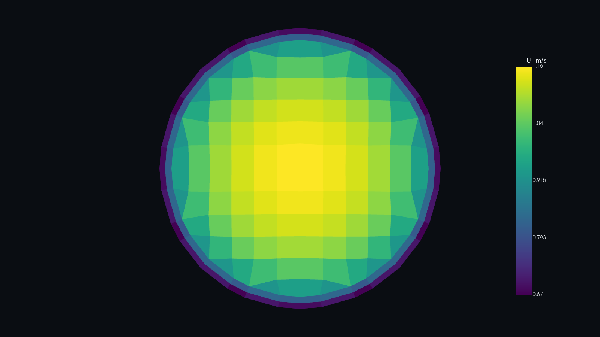
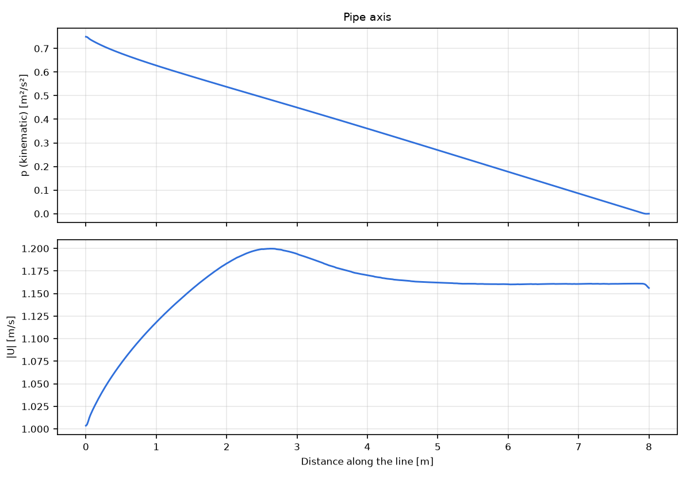

# 4. Internal flow

In an internal project the fluid is the inside of a closed geometry: there is no far-field domain, and every surface
patch is an inlet, an outlet or a wall (D-129).

## 4.1 The presets and the geometry

File > New Simulation, preset **Internal flow** (3D, wall functions) or **2D internal flow** (a section,
wall-resolved). Import ONE closed surface whose solids (a multi-solid STL) or CAD faces separate the inlets, the
outlets and the walls: in an internal project each solid becomes its own patch. An open geometry is refused with the
number of open edges; close it with Edit > Prepare Surfaces or Repair part.

## 4.2 Patch roles

Regions > Fluid Region lists the patches. Select one and set its **Role**: inlet, outlet or wall. A patch is a wall
until you set it. A region keeps its name as the mesh patch (internal projects reserve no names). The app finds the
point inside the fluid (locationInMesh) itself.

## 4.3 Which inlet

| Inlet type | Use it when | Notes |
|---|---|---|
| Mass flow | the flow rate is known | the most robust: the validation pipe converged in 502 iterations |
| Velocity | the inlet speed is known | a uniform speed normal to the patch |
| Total pressure | a plenum or reservoir at a known pressure | the flow rate follows from the losses; solved with SIMPLE and a relaxed pressure (D-131): slower, 1,858 iterations on the same pipe |

Inlet turbulence: an intensity (default 5 %) and a length scale (default 0.07 x the patch's hydraulic diameter).
The outlet is a static pressure (default 0), safe on backflow.

## 4.4 Pressure drop

Reports & Monitors > Planes & Pressure Drops: add cutting planes (a point and a normal) and pressure drops between
two locations (patches or planes). The Internal flow table shows the mass flow and the area- and mass-averaged
static and total pressure per inlet, outlet and plane, and each pressure drop. Pressures are kinematic in OpenFOAM;
the app reports them in Pa with the reference density (Physics).

For friction losses put two planes in the developed region (the validation pipe: 50 and 70 diameters from the
inlet) and read the static pressure drop between them. The planes are written a hair (1e-6 of the parts' extent)
along their normal, so they never lie on a layer of mesh faces.

*The validation pipe (Re 1e5, mass-flow inlet, wall functions): |U| on a cross-section at 60 diameters, in the
developed region.*

A line plot along the axis shows where the flow develops and the linear pressure fall of the developed region:

## 4.5 What to expect

The validation pipe gives the Darcy friction factor within 1.4 % of Prandtl-Karman with a mass balance of 0.0 %,
and the total-pressure inlet reproduces the flow rate within 0.03 % (docs/validation/pipe/RESULT.md).
