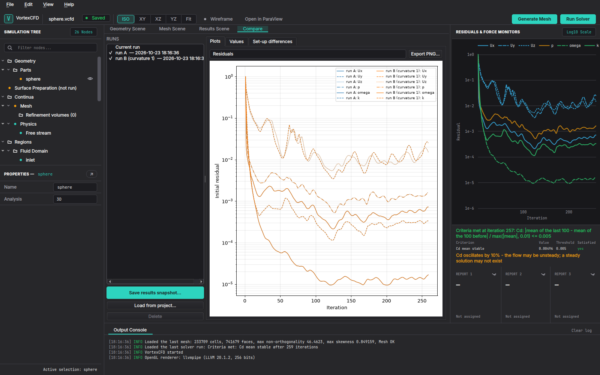

# 5. Reading the results and making a report

## 5.1 The Results Scene

The Results Scene tab reads the latest time of the case. Its strip: the field (p, Cp, |U| and components, k,
omega, nut, y+, wall shear stress, Cf and Cf_x on the walls), the colormap, the colour range (auto, fixed with
your limits, or symmetric about zero), the display (walls, section, both), Separation (wall faces where Cf_x < 0
in the error colour) and Sections (Cp against x/c on cuts of the walls, with CSV export). Open in ParaView is in
the top bar.

"Results out of date" means the set-up changed after the run: run the solver again before you trust the numbers.

## 5.2 Monitors and windowed means

The report slots in the right column show each quantity's last value, its mean over the last iterations and the
half range of its oscillation. Reports & Monitors holds the Forces table (Cd, Cl, CmPitch, the pressure and
viscous drag, per wall and per part) or, in internal flow, the Internal flow table. When a run oscillates, read
the windowed means, not the last values (chapter 7).

## 5.3 Results objects

The **Results** node (in the tree, after Reports & Monitors) adds objects to the Results Scene; each edit is one
undo step and each object says on its node why it draws nothing (no results yet, a plane or seeds outside the
fluid, a value outside the field's range):

- **Clip**: the fluid on one side of a plane (point, normal, side kept), coloured by the scene's field.
- **Isosurface**: where a field equals a value, coloured by the scene's field.
- **Streamlines**: from seeds on a line or a square plane, forward, backward or both ways, coloured by their own
  field with their own colormap, colour range (auto, fixed, symmetric) and scalar bar (on the left of the view).
- **Line plot**: fields sampled at evenly spaced points between two points. Its node shows the chart (one panel
  per field, against the distance along the line; samples outside the fluid are gaps) with **Export PNG** and
  **Export CSV** (distance, x, y, z and each field). The viewer draws the line itself, so saved views show where
  it is.

**Save view** stores the viewer's camera by name; select a saved view and Show to return to it.

## 5.4 Images

File > Export Image (or the Results node's Export image): 1920 x 1080, 2560 x 1440, 3840 x 2160 or a custom size,
optionally with a transparent background. The scene is rendered again at that size (not a screenshot scaled up),
with the viewer's camera and scalar bars; the telemetry card is left out. Every 3D picture in this manual was made
this way.

Images and reports made with versions before 1.0.0rc1 (before the camera fix, D-133 note) show PyVista's default
view instead of the viewer's or the saved camera: make them again.

## 5.5 The HTML report

File > Create Report (or the Results node's Create report) first asks which sections to include; the choice is
remembered in the project. The sections:

| Section | Content |
|---|---|
| Project and set-up | analysis, physics, free stream or boundaries, reference values, iteration limit, stopping criteria |
| Geometry | parts, files, patches, surface preparation, refinement volumes |
| Mesh report | cells, checkMesh, quality, layer coverage, first cell against the plan, walls' y+ |
| Convergence | stop reason, iterations, final residuals, time, a residual plot |
| Forces / internal-flow reports | windowed means with the half range (the mean-stable window, else the oscillation window) |
| Mesh independence study | per quantity: the value on each level, the convergence, the order, the extrapolated value and the GCI, or why there is none |
| Polar sweep | CL, CD, CM, L/D, iterations and stop per angle, and the plot of CL, CD and CM against the angle |
| Line plots | each line plot's chart |
| Comparison | only when two or more runs are ticked in the Compare tab: the values with their differences, the set-up differences, the residual and report overlays |
| Saved views | each saved view rendered at 1600 x 900 |

The report is one self-contained HTML file in `<project>/reports/` (styles and images inside it): open it in any
browser, mail it, or print it to PDF. A section with no data says so in one line; nothing is estimated.

## 5.6 Comparing runs

A new mesh or run replaces the previous results, so keep a run before you change the set-up: in the **Compare** tab
(next to the Results Scene) press **Save results snapshot...** and give it a name. A snapshot keeps the residual
history, every report's history with its final value and windowed mean, the line plots (as shown in the Results
Scene), the mesh summary and the key inputs; it is a small file in `<project>/snapshots/` (ignored by git).
**Load from project...** adds the snapshots of another project, read-only.

Tick two or more runs (the current run is listed too); the first ticked one is the reference:

- **Plots**: the residuals, any report's history or any line plot field, one colour per run (Export PNG).
- **Values**: each quantity's windowed mean (or final value) and the mesh cells per run, with the difference and the
  relative difference to the reference (Export CSV).
- **Set-up differences**: only the inputs that differ between the runs (Export CSV).

File > Create Report adds a Comparison section with the same tables and the first two overlays while runs are
ticked.

