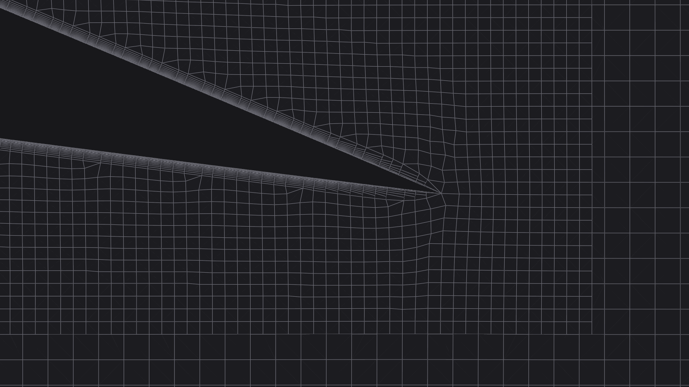

# 6. Meshing guidance

The mesher is snappyHexMesh: a background box of hexahedra, refined towards the parts, snapped to the surface,
with prism layers on the walls. Continua > Mesh shows the settings and, before you mesh, the estimate (background
cells, surface cell size, layers).

## 6.1 y+ and wall treatment

The first-layer thickness comes from a target y+ (Mesh > Layer sizing "y+"); the estimate uses the flat-plate skin
friction at the free-stream speed (in internal flow, the reference inlet's bulk speed) and puts the target at the
first cell centre.

| Wall treatment | Target y+ | When | Cost |
|---|---|---|---|
| Wall functions (the default "robust" layer controls) | 30 to 300 | 3D bodies, internal flow, anything where the near-wall profile is not the question | modest: at most 12 layers, expansion up to 1.3 |
| Wall-resolved | about 1 | 2D sections, separation from smooth surfaces, skin friction | high: the surface is refined to at most 220 first layers |

A target y+ below 5 switches the wall-resolved controls on automatically (D-123); you can also choose them in
Mesh > Layer controls "wall_resolved" (D-122). Wall-resolved layers are fine for 2D sections and costly on 3D
bodies. With wall-resolved meshes the solver runs the two turbulence stages of chapter 3 (D-126).

After meshing, the Mesh report's **First cell** row is the achieved wall-adjacent cell height (area-weighted mean
and 95th percentile) against the plan; the walls' y+ is in the report slots once the solver has run.

## 6.2 Layer warnings

Before meshing the Mesh properties may warn:

- *The layer stack is thinner than planned: N layers (the cap) at expansion ratio r reach ... of the planned ...*:
  the stack the y+ asks for needs more than the layer cap; the first layer is kept (y+ holds), the stack is thinner.
- *The wall-resolved stack is thinner than one surface cell* or *The surface cell (...) is more than 220 first
  layers (...): wall-resolved layers collapse on it; refine the surface.*: refine the surface (a smaller surface
  size) or raise the target y+.
- Thin or small parts get seed lines automatically (the castellation keeps them).

After meshing, the Mesh report's layer table gives, per patch, the faces with layers, the layers achieved and the
thickness as a share of the target. Low coverage at sharp edges (trailing edges, the slant edges of a car body) is
normal for snappyHexMesh; low coverage over a whole patch is not. See chapter 7 for the first-cell drift warning.

*Wall-resolved layers at the NACA 0012 trailing edge (Mesh Scene, the 15 degree case).*

## 6.3 Refinement volumes

Continua > Mesh > Refinement volumes: boxes, cylinders, spheres and cones with a target cell size; the node shows
the level, the achieved size, the share inside the domain and the extra cells (D-103). Any closed surface can be a
refinement region too (D-145): right-click Refinement volumes > Add from imported geometry (STL, OBJ, PLY, STEP,
IGES, BREP), or right-click a part > Use as refinement region (it then stops being a wall). Such a region refines
every cell inside it, or every cell within a distance of its surface ("Refine" on its node); it is never meshed as
a wall. Edit > Add Wake Volume adds a
box behind the selected part (all parts when none is selected), aligned with the free stream. Use a volume where the
flow needs resolution away from the walls: wakes, a ground gap, a jet. Each volume adds to the cell estimate; the
estimate's budget is 2,000,000 background cells.

## 6.4 Parallel meshing

Mesh cores (Mesh properties): automatic by default, the Solvers cores capped by a recommendation from the estimated
cells; or a number. With more than one core snappyHexMesh runs under mpirun on one decomposition and the mesh is
reconstructed afterwards, so everything after meshing (checkMesh, the solver, the viewer) reads the usual serial
mesh (D-111). The mesh is the same quality as a serial one, not cell-for-cell identical.

On the development machine (12 cores) the solver's parallel speed-up saturates at about 3 on 8 cores (memory
bandwidth), so the recommended cores are capped at 4 (docs/validation/parallel/README.md).

Curvature refinement adds up to "Curvature levels" levels (default 2, at most 4) where surfaces bend: each extra
level can multiply the cells near curved surfaces several times, so watch the cell estimate.

## 6.5 A mesh independence study

Reports & Monitors > Mesh independence study runs three levels at a constant refinement ratio (default the square root of 2) and
reports the Celik grid convergence index of the chosen quantities (D-066). In 2D the levels are refined everywhere.
In 3D the levels do not refine the near field by the level ratio (D-127, a known limitation): a 3D study's GCI
covers the wall cells and the background and is indicative only (chapter 8).
